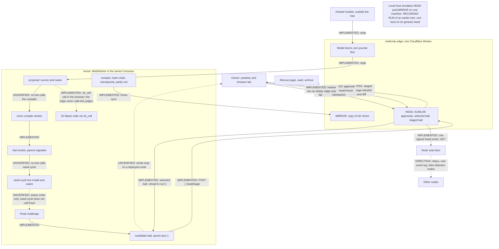

# Architecture map

English | [中文](ARCHITECTURE-MAP.zh.md)

Aukora keeps two things apart: the AI that proposes a change, and the authority that permits it. This page draws both, follows one self-change from proposal to live, and states what each part is trusted with.

Labels: IMPLEMENTED (code and tests in this tree), RECORDED RUN (shown in [RUN-RECORD.md](RUN-RECORD.md), a run of an earlier tree), INDEPENDENTLY VERIFIED (nothing has this label yet), UNVERIFIED (claimed or written, but no test here holds it or no run shows it), DIRECTION (not built). "Green" means a test file ran without failure in the RECORDED RUN (of an earlier tree). Most claims here are listed with their tests in [WHAT-IS-BUILT.md](WHAT-IS-BUILT.md).

Names used below, each in one sentence ([GLOSSARY.md](GLOSSARY.md) defines ball, organ, epoch, receipts and the lineage terms in more detail). **Auma** is the personal AI that runs on a node. An **organ** is one replaceable module of her. A **ball** is the manifest that lists every organ by SHA-256, and its **epoch** is its version number. **HEAD** is the edge store that selects which ball runs; **MIRROR** is the edge store that keeps a copy of her home. **AUMLOK** is the identity door: passkeys, devices, the seven words (the owner's recovery phrase, which seals the node's root key) and exact-bytes approval. The **scion** compiles a candidate organ. **Pearl** is the retention suite a candidate is graded against, with founding lessons called **scars**.

## The picture

```text
 OWNER: passkey device + browser tab                   I = IMPLEMENTED
   | (I) sign in; approve exact bytes                  R = RECORDED RUN
   | (I) the page rebuilds the terms and the diff      U = UNVERIFIED
   v                                                    D = DIRECTION
+----------------------------------------------------------------------+
| AUTHORITY EDGE: one Cloudflare Worker (worker.mjs)                   |
|  model doors /door/<provider>/, turn journalled first (I)            |
|  HEAD object  : AUMLOK approvals, selected ball, staged ball (I)     |
|  MIRROR object: copy of her home, ordered updates (I)                |
+----------------------------------------------------------------------+
   ^ (I) stage; promote (approval spent in the head-move transaction)
   | v (I) selected ball; the tab reloads to run it
   | ^ (I) home sync to MIRROR; receipts ride along
   | v (I) model replies, through a door only
+----------------------------------------------------------------------+
| AUMA: a WebWorker in the owner's browser (ball-loader.ts)            |
|  propose -> scion compile (U) -> trial, parent regrades (I)          |
|  -> seed-cycle live install (U) -> Pearl (I) -> ball +1 epoch (I)    |
|  25 Wasm cells via x6_cell (I); no edge module loads the judges      |
|  receipts: hash chain, signed checkpoints (I; 6 cases red)           |
+----------------------------------------------------------------------+
 MODELS: hosted providers outside the tree, reached only through a door.
 NOSTR (I): one signed head event, read by GET; publishing needs a passkey.
            Relays, her own event log, links between nodes: (D).
 RESCUE (I): page, vault, archive; restore only into an EMPTY edge.
 LOCAL HOST (R): server/local-host.mjs emulates HEAD and MIRROR on one
            machine; booted once on the genesis head.
 ORDER inside the AUMA box: as drawn only; seed-cycle does not call
            Pearl (U).
 WHOLE LOOP on a deployed node with a real passkey: no record (U).
```



## The life of one self-change

Edge paths are under `deploy/cloudflare/src/`, runtime paths under `packages/experimental/webworker-runtime/src/x6/`, organs under `mirror/home/auma/seed/organs/`.

**No recorded run from here on.** The RECORDED RUN of an earlier tree made no model call, opened no browser and used no passkey, so not one step below has been recorded as part of a real self-change. Where a step says "green", only its test file ran.

1. **Propose.** A model reply arrives through the Worker's door, and the turn is journalled before the provider is called. `worker.mjs` `providerDoor`, `turn-journal.mjs`, `provider-dispatch.mjs`. IMPLEMENTED: `provider-dispatch.test.mjs`, `turn-journal-and-body.test.mjs`, green. No model call recorded.
2. **Compile.** `scion.ts` `createScionCompiler().compile`, then `runScionWorker` in a separate worker: a pinned offline compiler, checked by size and SHA-256, at most 128 files and 2 MiB, output hash `outputSha256`. UNVERIFIED: **this is the first step with no test at all**; no test in the tree calls the compiler.
3. **Trial.** `scion-growth.ts` `trialScionCandidate`, called by `growScionOrgan`: a disposable worker; the parent grades the outputs again and ignores the candidate's own pass flags. IMPLEMENTED: `scion-growth.spec.ts`, 73 cases, one unrelated case known red. Not proven containment.
4. **Live cycle.** `seed-cycle.js`, action `grow`: write the file, hash it, `ctx.organs.install`, run the cases on the live organ, `undo` or `retire` on failure, one line in `ledger.jsonl` (plain lines, no hash chain). UNVERIFIED: no test calls it. The cases run on the live organ, not in isolation.
5. **Pearl.** A separate call: no code goes from step 4 to this one (`seed-cycle.js` does not name Pearl, and `growScionOrgan` in `scion-growth.ts` stops at the cycle). `seed-pearl.js` `challenge` with `ball-loader.ts` `trialRetentionCandidate`: two builds against the whole suite, a `pearl.challenge` receipt, a local qualification id. IMPLEMENTED: `server/pearl.test.mjs`, green. Self-attested: its receipts say `authorityVerified: false`, and a deployed HEAD does not read Pearl.
6. **Candidate ball.** `ball-loader.ts` `treePatch` or `buildOrganPromotion` clones the head and adds one epoch; a governance change uses `computeCanonicalBallId`. A protected organ is staged, never mounted. IMPLEMENTED: `stage-organ-promotion.spec.ts`, `head-promotion.spec.ts`, green.
7. **Stage.** `head-do.mjs` `stage`, by `POST /_head/stage`: checks parent and epoch, hashes every module, stores `head:staged-promotion`. The head does not move. IMPLEMENTED: `head-hardening.test.mjs`, green.
8. **The owner sees it.** `packages/client/ui-layout/src/client/spatial/aumlok/head-promotion.ts` rebuilds the terms from the bytes; `spatial/portal/organ-code-diff.ts` shows the diff. IMPLEMENTED in jsdom: `organ-code-diff.client.spec.ts`, `sovereignty-durability.client.spec.tsx`, green. No browser session recorded.
9. **Approve.** `aumlok.mjs` store `complete('approve', ...)`: screen the assertion (`webauthn-screen.mjs`), check it inside `proofOutcome` (`proof-failure-rule.mjs`), store the hash of a one-time secret (`approvalToken`) with the binding, 5 minutes. IMPLEMENTED with hand-built passkey data in `aumlok-restore-rehearsal.test.mjs`, green. No real authenticator recorded.
10. **Promote.** `head-do.mjs` `publish`, by `POST /_head/promote`: epoch, lease and module hashes, then `consumeApprovalInTransaction` and `tx.put('head', ...)` in one transaction. IMPLEMENTED: `head-hardening.test.mjs` ("expired approval rolls back both consumption and HEAD selection"), `aumlok-restore-rehearsal.test.mjs`, green.
11. **Record and adopt.** HEAD writes `head:last-publish-outcome`; the page appends a receipt (`seed-receipts.js`) and syncs to MIRROR; a tab never hot-swaps a promoted head, and `head_adopt` says to reload. IMPLEMENTED. Partly red: `server/receipts.test.mjs` failed 6 cases in the RECORDED RUN (of an earlier tree) (10 are written).

The whole loop, steps 1 to 11, on a deployed node with a real passkey: no record. UNVERIFIED.

Two side roads skip steps 7 to 9. An owner sign-in session (8 hours at most) alone lets the edge swap the code of one existing unprotected organ when the ball carries the canonical id (`server/ball-transition.mjs` `classifyTransition`; `signed-head-actions.test.mjs`). The night grant covers ordinary additions and code-only updates within its limits (below).

## Trust boundaries

**What the edge trusts.**
- A passkey assertion, after its own screen (`webauthn-screen.mjs`) and the `@simplewebauthn/server` check inside `proofOutcome`. The authenticator signs a random challenge, not the bytes; the bytes are bound by what the edge stored with that challenge (`aumlokClass3Binding`, `headPromotionBinding`).
- Its own Durable Object storage. Whoever can roll that storage back can re-enable a spent approval: `aumlok-restore-rehearsal.test.mjs` reproduces three such gaps, with ten todo cases beside them (nine named gaps and one positive recovery case). Which accounts can write that storage: UNVERIFIED.
- Its own code and settings: the deployed Worker, `OWNER_PUBLIC_KEY_HEX`, `PUBLIC_HOST`, the provider keys. The list of protected ids is Worker source; changing it is a deploy, and no passkey gates a deploy.
- The Cloudflare runtime itself. This dependence is real; the local host (`server/local-host.mjs`) emulates the edge on one machine, but no other deployment target is in the tree.

**What the browser is trusted with.**
- Running Auma, her organs and her home (IndexedDB, synced to MIRROR).
- Showing the owner the true bytes. No independent display is in the tree: a compromised page could ask the passkey for terms the owner did not read.
- The node key, derived from a root sealed by the seven words and released only after the bound passkey asserts (`spatial/aumlok/aumlok-root.ts`). The receipt checkpoint key is a JWK file in her home (`seed-receipts.js`).
- Mounting local changes. A local `tree_patch` mounts before the edge answers, so a tab can run an organ the edge refused; the edge still decides which ball is selected.

**What a model is trusted with.** Nothing that permits. A model writes text and tool calls inside the tab. It holds no provider key (a door lets the host add a key only it holds, `model-doors.ts`), cannot approve, and its output reaches the head only through the same edge checks as any other proposal. The cloud wake's model turn writes, stages, approves and publishes nothing (`cloud-wake-tools.mjs`). Spoken turns never authorise an agent (`voice-director.mjs`).

**Where delegated permission exists.**
- The night grant (`night-grant.mjs`, `night-grant.test.mjs`): one passkey approval; at most 12 hours (`NIGHT_GRANT_MAX_LIFETIME_MS`), at most 12 uses (`NIGHT_GRANT_MAX_USES`), at most 8 organs per use (`NIGHT_GRANT_MAX_ORGANS_PER_USE`); scope `add-or-update-non-governance-organs`; issued against the current head and epoch; revocable; governance ids never covered.
- The owner sign-in session: 8 hours at most (`AUMLOK_SIGNIN_LIMITS` in `aumlok.mjs`), at most 8 sessions; it is not an approval, but it does permit the one-organ side road above: its scope may name up to 128 ordinary organs, one changed per promotion (`ownerSessionPermitsTransition` in `server/ball-transition.mjs`, `effectiveOwnerSession` in `head-do.mjs`).
- The cloud wake: 3 rounds, 6 tool calls, 15 seconds (`CLOUD_WAKE_LIMITS`), read-only tools, off unless `WAKE_EXECUTOR_ENABLED=1`.

**What must never be confused.**
- A model is not the owner.
- A proposal is not an authorised effect.
- A hash is not an approval.
- A signed checkpoint does not prove that every earlier decision was authorised. The pinned checkpoint signer keys in this tree are synthetic.
- A green unit test is not an end-to-end guarantee. The RECORDED RUN (of an earlier tree) had 5,502 cases, 5,399 passed and 90 failed (89 on [KNOWN-RED-TESTS.md](KNOWN-RED-TESTS.md)), with no browser, deployment, model call or passkey.
- Her own grading (Pearl, the trial regrade) is not independent acceptance.
- Open source is not by itself reproducible or sovereign. 24 of the 25 Wasm cells and the Dakini Code bundle (a prebuilt stock app, three files in `apps/web/public/assets/stock-apps/dakini-code/assets/`) ship as binaries without their source, and `pentora36.wasm` ships with no licence granted yet. No second build has been compared.
- The dependence on Cloudflare and on a hosted model is real. Every model door in `model-doors.ts` points at a hosted provider; no local-model door is in the tree.

## Where each layer comes from

Most of this tree is inherited. Most of `packages/` is the DeepSeek Harness runtime (MIT, [LICENSES/MIT-DeepSeek-Harness.txt](../LICENSES/MIT-DeepSeek-Harness.txt)), and the plugin framework that organs are built on is Cordis, vendored in `vendor/`. Aukora's own layer is concentrated in `deploy/cloudflare/src/` (the edge), `server/`, `mirror/home/auma/seed/` (the organs and Pearl), `packages/experimental/webworker-runtime/src/x6/` (the loader, scion and cell loader), `packages/client/ui-layout/src/client/spatial/` (the app) and `apps/web/public/cells/` (the cells, as binaries). By one count, made once by the project from its own history, which is not public, and not yet repeated by anyone else (UNVERIFIED), 11.6% of the non-vendored text lines and 14.3% of the code lines are Aukora's own. The method, the tables and the files without source are in [SIZE-AND-ORIGIN.md](SIZE-AND-ORIGIN.md).
