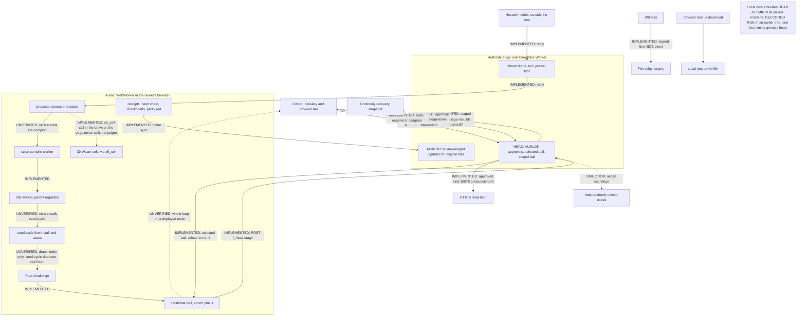

# Architecture map

Aukora keeps two things apart: the AI that proposes a change, and the authority that permits it. This page draws both, follows one self-change from proposal to live, and states what each part is trusted with.

Labels: IMPLEMENTED (code and tests in this tree), RECORDED RUN (shown in [RUN-RECORD.md](RUN-RECORD.md), a run of an earlier tree), INDEPENDENTLY VERIFIED (nothing has this label yet), UNVERIFIED (claimed or written, but no test here holds it or no run shows it), DIRECTION (not built). "Green" means a test file ran without failure in the RECORDED RUN (of an earlier tree). Most claims here are listed with their tests in [WHAT-IS-BUILT.md](WHAT-IS-BUILT.md).

Names used below, each in one sentence ([GLOSSARY.md](GLOSSARY.md) defines ball, organ, epoch, receipts and the lineage terms in more detail). **Auma** is the personal AI that runs on a node. An **organ** is one replaceable module of her. A **ball** is the manifest that lists organ module specifiers, and its **epoch** is its version number. **HEAD** is the edge store that records the selected ball; **MIRROR** is the edge store that keeps acknowledged updates for eligible files. **AUMLOK** is the identity door: passkeys, devices, the seven words (they seal the node's root key, which is released only after an enrolled passkey confirms; recovery after losing every device is not built) and request approval. The **scion** compiles a candidate organ. **Pearl** grades a candidate against the retention suite. **Scars** record failures and can name guarding checks.

## The picture

```text
 OWNER: passkey device + browser tab                   I = IMPLEMENTED
   | (I) sign in; authorize requests                   R = RECORDED RUN
   | (I) the page rebuilds the terms and the diff      U = UNVERIFIED
   v                                                    D = DIRECTION
+----------------------------------------------------------------------+
| AUTHORITY EDGE: one Cloudflare Worker (worker.mjs)                   |
|  model doors /door/<provider>/, turn journalled first (I)            |
|  HEAD object  : AUMLOK approvals, selected ball, staged ball (I)     |
|  MIRROR object: acknowledged updates for eligible files, ordered updates (I)                |
+----------------------------------------------------------------------+
   ^ (I) stage; promote (approval spent in the head-move transaction)
   | v (I) selected ball; the tab reloads to run it
   | ^ (I) home sync to MIRROR; receipts ride along
   | v (I) model replies through configured doors
+----------------------------------------------------------------------+
| AUMA: a WebWorker in the owner's browser (ball-loader.ts)            |
|  propose -> scion compile (U) -> trial, parent regrades (I)          |
|  -> seed-cycle live install (U) -> Pearl (I) -> ball +1 epoch (I)    |
|  30 Wasm cells via x6_cell (I); no edge module loads the judges      |
|  receipts: hash chain, signed checkpoints (I; 6 cases red)           |
+----------------------------------------------------------------------+
 MODELS: the routing helper rewrites recognized provider URLs to same-origin doors. Other URLs pass through unchanged.
 NOSTR (I): approved kind 30078 head announcement over HTTPS. The witness
            attempts delivery of signed kind 4871 events to five relays.
            Action exchange between independently owned nodes: (D).
 RESCUE (I): browser download and local verifier. Continuity snapshots
             can seed an empty edge, resume a matching partial seed, or
             be compared with an established edge.
 LOCAL HOST (R): server/local-host.mjs emulates HEAD and MIRROR on one
            machine; booted once on the genesis head.
 ORDER inside the AUMA box: as drawn only; seed-cycle does not call
            Pearl (U).
 WHOLE LOOP on a deployed node with a real passkey: no record (U).
```



## The life of one self-change

Edge paths are under `deploy/cloudflare/src/`, runtime paths under `packages/experimental/webworker-runtime/src/x6/`, organs under `mirror/home/auma/seed/organs/`.

**No recorded run from here on.** The RECORDED RUN of an earlier tree made no model call, opened no browser and used no passkey, so not one step below has been recorded as part of a real self-change. Where a step says "green", only its test file ran.

1. **Propose.** Before forwarding an inference POST, the provider door journals the request. `worker.mjs` `providerDoor`, `turn-journal.mjs`, `provider-dispatch.mjs`. IMPLEMENTED: `provider-dispatch.test.mjs`, `turn-journal-and-body.test.mjs`, green. No model call recorded.
2. **Compile.** `scion.ts` `createScionCompiler().compile`, then `runScionWorker` in a separate worker: a same-origin compiler asset fetched and checked by size and SHA-256, at most 128 files and 2 MiB, output hash `outputSha256`. UNVERIFIED: **this is the first step with no test at all**; no test in the tree calls the compiler.
3. **Trial.** `scion-growth.ts` `trialScionCandidate`, called by `growScionOrgan`: a disposable worker; the parent grades the outputs again and ignores the candidate's own pass flags. IMPLEMENTED. `scion-growth.spec.ts`, 74 matching declarations, including parameterized tests. Containment remains unverified.
4. **Live cycle.** `seed-cycle.js`, action `grow`: write the file, hash it, `ctx.organs.install`, run the cases on the live organ, `undo` or `retire` on failure, one line in `ledger.jsonl` (plain lines, no hash chain). UNVERIFIED: no test calls it. The cases run on the live organ, not in isolation.
5. **Pearl.** A separate call: no code goes from step 4 to this one (`seed-cycle.js` does not name Pearl, and `growScionOrgan` in `scion-growth.ts` stops at the cycle). `seed-pearl.js` `challenge` with `ball-loader.ts` `trialRetentionCandidate`: two builds against the whole suite, a `pearl.challenge` receipt, a local qualification id. The authors reported the Pearl suite green in their earlier run. Its default behavior checks use a pinned fixture. A separate check loads the supplied organ and inspects its exports (`server/pearl.test.mjs`). Self-attested: its receipts say `authorityVerified: false`.
6. **Candidate ball.** The protected-promotion staging tool prepares a candidate for review. On boot the browser attempts to mount entries from the selected ball. IMPLEMENTED. See `stage-organ-promotion.spec.ts` and `head-promotion.spec.ts`.
7. **Stage.** `head-do.mjs` `stage`, by `POST /_head/stage`: checks parent and epoch, hashes every module, stores `head:staged-promotion`. The head does not move. IMPLEMENTED: `head-hardening.test.mjs`, green.
8. **Review.** For a protected promotion, `packages/client/ui-layout/src/client/spatial/aumlok/head-promotion.ts` derives the binding. The source comparison in `spatial/portal/organ-code-diff.ts` can clip or elide lines. IMPLEMENTED. See `organ-code-diff.client.spec.ts` for the comparison and [r29-edge-e2e.client.spec.tsx:1146](../packages/client/ui-layout/tests/r29-edge-e2e.client.spec.tsx#L1146) for the review card.
9. **Approve.** `aumlok.mjs` store `complete('approve', ...)`: screen the assertion (`webauthn-screen.mjs`), check it inside `proofOutcome` (`proof-failure-rule.mjs`), store the hash of a one-time secret with the binding, 5 minutes. IMPLEMENTED with hand-built passkey data in `aumlok-restore-rehearsal.test.mjs`, green. No real authenticator recorded.
10. **Promote.** `head-do.mjs` `publish`, by `POST /_head/promote`: epoch, lease and module hashes, then `consumeApprovalInTransaction` and `tx.put('head', ...)` in one transaction. IMPLEMENTED: `head-hardening.test.mjs` ("expired approval rolls back both consumption and HEAD selection"), `aumlok-restore-rehearsal.test.mjs`, green.
11. **Record and adopt.** HEAD writes `head:last-publish-outcome`; the page appends a receipt (`seed-receipts.js`) and syncs to MIRROR; a tab never hot-swaps a promoted head, and `head_adopt` says to reload. IMPLEMENTED. Partly red: `server/receipts.test.mjs` failed 6 cases in the RECORDED RUN (of an earlier tree) (10 are written).

The whole loop, steps 1 to 11, on a deployed node with a real passkey: no record. UNVERIFIED.

For ordinary replacements under an owner session, see `server/ball-transition.mjs` (`classifyTransition`) and `signed-head-actions.test.mjs`. A separate night grant can cover one eligible ordinary replacement.

## Trust boundaries

**What the edge trusts.**
- A passkey assertion, after its own screen (`webauthn-screen.mjs`) and the `@simplewebauthn/server` check inside `proofOutcome`. The authenticator signs its data and the hash of client data containing the challenge.
- Its own Durable Object storage. `aumlok-restore-rehearsal.test.mjs` exercises rollback in a fixture. Deployed account permissions are unverified.
- Its own code and settings: the deployed Worker, `OWNER_PUBLIC_KEY_HEX`, `PUBLIC_HOST`, the provider keys. The list of protected ids is Worker source; changing it is a deploy.
- The Cloudflare runtime itself. This dependence is real; the local host (`server/local-host.mjs`) emulates the edge on one machine, but no other deployment target is in the tree.

**What the browser is trusted with.**
- Running Auma, her organs and her home (IndexedDB, synced to MIRROR).
- Displaying the proposed terms on the requesting page. The project cites no independent display.
- The node key, derived from a root sealed by the seven words and released only after the bound passkey asserts (`spatial/aumlok/aumlok-root.ts`). The receipt checkpoint key is a JWK file in her home (`seed-receipts.js`).
- Mounting local changes. A local `tree_patch` mounts before the edge answers, so a tab can run an organ the edge refused; the edge still decides which ball is selected.

**Model routing.** The browser routing helper maps recognized provider URLs to configured doors ([model-doors.ts:35](../packages/experimental/webworker-runtime/src/model-doors.ts#L35)). A configured door can add a server-held credential ([cloud-model-door.mjs:248](../deploy/cloudflare/src/cloud-model-door.mjs#L248)). The shipped wake-act setting is `WAKE_ACTS_ENABLED = "1"`. The evidence checkpoint ships paused (`CLOUD_WAKE_CHECKPOINT_PAUSED` in `deploy/cloudflare/src/head-do.mjs`).

**Where delegated permission exists.**
- The night grant (`night-grant.mjs`, `night-grant.test.mjs`): one passkey approval; at most 12 hours (`NIGHT_GRANT_MAX_LIFETIME_MS`), at most 12 uses (`NIGHT_GRANT_MAX_USES`), at most 8 organs per use (`NIGHT_GRANT_MAX_ORGANS_PER_USE`); scope `add-or-update-non-governance-organs`; issued against the current head and epoch; revocable; governance ids never covered.
- Passkey sign-in can issue an eight-hour session, with up to eight stored sessions (`AUMLOK_SIGNIN_LIMITS` in `aumlok.mjs`). The separate signed owner-login cookie lasts for the assertion’s remaining validity, up to 24 hours (`access.mjs`, `worker.mjs`). On the ordinary-organ session route the scope can name up to 128 ordinary organs, with one changed per promotion (`ownerSessionPermitsTransition` in `server/ball-transition.mjs`).
- The cloud wake: up to 4 model rounds and 8 executed tool calls, with a 30-second cancellation timer (`CLOUD_WAKE_LIMITS`). It runs only when `WAKE_EXECUTOR_ENABLED` is `"1"`, which the shipped `deploy/cloudflare/wrangler.toml` sets. Its tools can read and append a note to her wish (the checkpoint to her home is paused); the act tools are offered only when `WAKE_ACTS_ENABLED` is `"1"` and the wish names an active mandate of the owner. The shipped file sets `"1"`.

**What must never be confused.**
- A model is not the owner.
- A proposal is not an authorised effect.
- A hash is not an approval.
- A signed checkpoint does not prove that every earlier decision was authorised. The pinned checkpoint signer keys in this tree are synthetic.
- The authors reported 5,502 cases, 5,399 passes, 90 failures, one skip and 12 todo in their earlier four-suite run. Of the failures, 89 fell within the counts then listed for those files. The [failure list](KNOWN-RED-TESTS.md) now includes the additional node-stubs failure. The run used no browser, deployment, model call or passkey.
- Her own grading (Pearl, the trial regrade) is not independent acceptance.
- Open source is not by itself reproducible or sovereign. 24 of the 30 Wasm cells and the Dakini Code bundle (a prebuilt stock app, three files in `apps/web/public/assets/stock-apps/dakini-code/assets/`) ship as binaries without their source. The component notice states, “The authors own pentora36.wasm and ship it without source and without a separate licence.” No second build has been compared.
- The dependence on Cloudflare and on a hosted model is real. Every model door in `model-doors.ts` points at a hosted provider; no local-model door is in the tree.

## Where each layer comes from

Most of this tree is inherited. Most of `packages/` is the DeepSeek Harness runtime (MIT, [LICENSES/MIT-DeepSeek-Harness.txt](../LICENSES/MIT-DeepSeek-Harness.txt)), and the plugin framework that organs are built on is Cordis, vendored in `vendor/`. Aukora's own layer is concentrated in `deploy/cloudflare/src/` (the edge), `server/`, `mirror/home/auma/seed/` (the organs and Pearl), `packages/experimental/webworker-runtime/src/x6/` (the loader, scion and cell loader), `packages/client/ui-layout/src/client/spatial/` (the app) and `apps/web/public/cells/` (the cells: binaries, six with WAT source beside them). By one count, made once by the project from its own history, which is not public, and not yet repeated by anyone else (UNVERIFIED), 18.3% of the non-vendored text lines and 20.4% of the code lines are Aukora's own. The method, the tables and the files without source are in [SIZE-AND-ORIGIN.md](SIZE-AND-ORIGIN.md).

This repository ships no Chinese translations of its documents. The application retains its Chinese interface strings.
