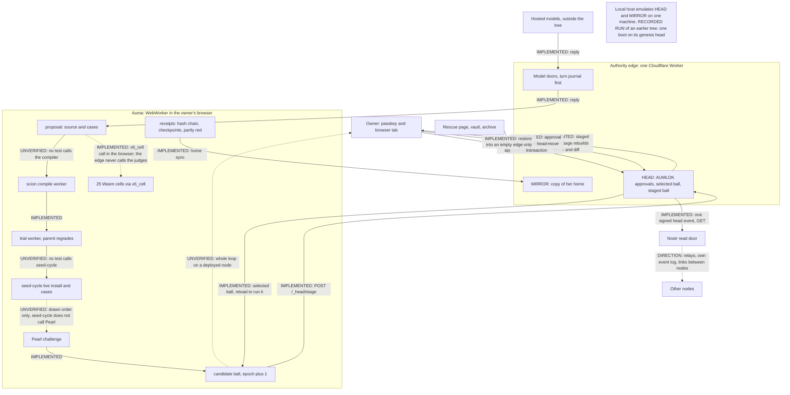

# 架构地图

[English](ARCHITECTURE-MAP.md) | 中文

Aukora 把两件事分开：提出修改的 AI，和许可修改的权威。本页画出这两者，沿着一次自我修改从提出到上线的全过程走一遍，并写明每个部分被信任做什么。

标签：IMPLEMENTED（本检出中有代码和测试）、RECORDED RUN（见 [RUN-RECORD.zh.md](RUN-RECORD.zh.md)，一次属于较早的一棵树的运行）、INDEPENDENTLY VERIFIED（目前没有任何内容带这个标签）、UNVERIFIED（已声称或已写出，但本检出中没有测试支撑，或没有运行记录显示）、DIRECTION（尚未构建）。“通过”指某个测试文件在 RECORDED RUN（属于较早的一棵树） 中运行时没有失败。本页多数声明连同其测试，列在 [WHAT-IS-BUILT.zh.md](WHAT-IS-BUILT.zh.md) 中。

下文用到的名字，各用一句话说明（[GLOSSARY.zh.md](GLOSSARY.zh.md) 对 ball、organ、epoch、收据和谱系术语有更详细的定义）。**Auma** 是运行在一个节点上的个人 AI。**organ** 是她的一个可替换模块。**ball** 是按 SHA-256 列出每个 organ 的清单，它的 **epoch** 是它的版本号。**HEAD** 是边缘存储，负责选定运行哪个 ball；**MIRROR** 是边缘存储，保存她的 home 的一份副本。**AUMLOK** 是身份之门：通行密钥、设备、七个词（所有者的恢复短语，用来封存节点的根密钥）和对确切字节的批准。**scion** 编译候选 organ。**Pearl** 是留存套件，候选要接受它的评分，其中的奠基教训称为 **scars**。

## 图示

```text
 OWNER: passkey device + browser tab                   I = IMPLEMENTED
   | (I) sign in; approve exact bytes                  R = RECORDED RUN
   | (I) the page rebuilds the terms and the diff      U = UNVERIFIED
   v                                                    D = DIRECTION
+----------------------------------------------------------------------+
| AUTHORITY EDGE: one Cloudflare Worker (worker.mjs)                   |
|  model doors /door/<provider>/, turn journalled first (I)            |
|  HEAD object  : AUMLOK approvals, selected ball, staged ball (I)     |
|  MIRROR object: copy of her home, ordered updates (I)                |
+----------------------------------------------------------------------+
   ^ (I) stage; promote (approval spent in the head-move transaction)
   | v (I) selected ball; the tab reloads to run it
   | ^ (I) home sync to MIRROR; receipts ride along
   | v (I) model replies, through a door only
+----------------------------------------------------------------------+
| AUMA: a WebWorker in the owner's browser (ball-loader.ts)            |
|  propose -> scion compile (U) -> trial, parent regrades (I)          |
|  -> seed-cycle live install (U) -> Pearl (I) -> ball +1 epoch (I)    |
|  25 Wasm cells via x6_cell (I); no edge module loads the judges      |
|  receipts: hash chain, signed checkpoints (I; 6 cases red)           |
+----------------------------------------------------------------------+
 MODELS: hosted providers outside the tree, reached only through a door.
 NOSTR (I): one signed head event, read by GET; publishing needs a passkey.
            Relays, her own event log, links between nodes: (D).
 RESCUE (I): page, vault, archive; restore only into an EMPTY edge.
 LOCAL HOST (R): server/local-host.mjs emulates HEAD and MIRROR on one
            machine; booted once on the genesis head.
 ORDER inside the AUMA box: as drawn only; seed-cycle does not call
            Pearl (U).
 WHOLE LOOP on a deployed node with a real passkey: no record (U).
```



## 一次自我修改的全过程

边缘路径在 `deploy/cloudflare/src/` 下，运行时路径在 `packages/experimental/webworker-runtime/src/x6/` 下，organ 在 `mirror/home/auma/seed/organs/` 下。

**此后没有任何运行记录。** RECORDED RUN（属于较早的一棵树） 没有调用模型，没有打开浏览器，也没有使用通行密钥，所以下面没有一步被记录为某次真实自我修改的一部分。凡写“通过”的步骤，都只是它的测试文件通过了。

1. **提出。** 模型的回复经 Worker 的门到达，轮次在调用供应商之前先写入日志。`worker.mjs` 的 `providerDoor`、`turn-journal.mjs`、`provider-dispatch.mjs`。IMPLEMENTED：`provider-dispatch.test.mjs`、`turn-journal-and-body.test.mjs`，通过。没有记录到模型调用。
2. **编译。** `scion.ts` 的 `createScionCompiler().compile`，然后是单独 worker 中的 `runScionWorker`：一个钉住版本的离线编译器，按大小和 SHA-256 检查，至多 128 个文件和 2 MiB，输出哈希为 `outputSha256`。UNVERIFIED：**这是第一个完全没有测试的步骤**；本检出中没有任何测试调用该编译器。
3. **试运行。** `scion-growth.ts` 的 `trialScionCandidate`，由 `growScionOrgan` 调用：一个用后即弃的 worker；父方重新给输出评分，忽略候选自己的通过标记。IMPLEMENTED：`scion-growth.spec.ts`，73 个用例，其中一个无关用例已知失败。这不是已证明的隔离。
4. **实时循环。** `seed-cycle.js`，动作 `grow`：写入文件，计算哈希，`ctx.organs.install`，在实时 organ 上运行用例，失败则 `undo` 或 `retire`，在 `ledger.jsonl` 中写一行（纯文本行，没有哈希链）。UNVERIFIED：没有测试调用它。这些用例在实时 organ 上运行，不在隔离环境中运行。
5. **Pearl。** 一次单独的调用：没有任何代码从第 4 步走到这一步（`seed-cycle.js` 没有提到 Pearl，`scion-growth.ts` 中的 `growScionOrgan` 止于该循环）。`seed-pearl.js` 的 `challenge` 加 `ball-loader.ts` 的 `trialRetentionCandidate`：用整个套件对两个构建评分，生成一条 `pearl.challenge` 收据和一个本地资格 id。IMPLEMENTED：`server/pearl.test.mjs`，通过。自我证明：它的收据写着 `authorityVerified: false`，部署的 HEAD 不读取 Pearl。
6. **候选 ball。** `ball-loader.ts` 的 `treePatch` 或 `buildOrganPromotion` 克隆 head 并加一个 epoch；治理类变更使用 `computeCanonicalBallId`。受保护的 organ 只暂存，从不挂载。IMPLEMENTED：`stage-organ-promotion.spec.ts`、`head-promotion.spec.ts`，通过。
7. **暂存。** `head-do.mjs` 的 `stage`，经 `POST /_head/stage`：检查父方和 epoch，对每个模块计算哈希，存入 `head:staged-promotion`。head 不移动。IMPLEMENTED：`head-hardening.test.mjs`，通过。
8. **所有者看到它。** `packages/client/ui-layout/src/client/spatial/aumlok/head-promotion.ts` 从字节重建条款；`spatial/portal/organ-code-diff.ts` 显示差异。在 jsdom 中 IMPLEMENTED：`organ-code-diff.client.spec.ts`、`sovereignty-durability.client.spec.tsx`，通过。没有记录到浏览器会话。
9. **批准。** `aumlok.mjs` 存储的 `complete('approve', ...)`：先筛查断言（`webauthn-screen.mjs`），在 `proofOutcome`（`proof-failure-rule.mjs`）内检查，把一次性秘密的哈希（`approvalToken`）连同绑定一起存下，有效期 5 分钟。IMPLEMENTED，用手工构造的通行密钥数据，见 `aumlok-restore-rehearsal.test.mjs`，通过。没有记录到真实的认证器。
10. **晋升。** `head-do.mjs` 的 `publish`，经 `POST /_head/promote`：检查 epoch、租约和模块哈希，然后在一个事务中执行 `consumeApprovalInTransaction` 和 `tx.put('head', ...)`。IMPLEMENTED：`head-hardening.test.mjs`（“expired approval rolls back both consumption and HEAD selection”）、`aumlok-restore-rehearsal.test.mjs`，通过。
11. **记录并采用。** HEAD 写入 `head:last-publish-outcome`；页面追加一条收据（`seed-receipts.js`）并同步到 MIRROR；标签页从不热替换已晋升的 head，由 `head_adopt` 提示重新加载。IMPLEMENTED。部分失败：`server/receipts.test.mjs` 在 RECORDED RUN（属于较早的一棵树） 中有 6 个用例失败（共写了 10 个）。

整个循环，第 1 步到第 11 步，在带真实通行密钥的已部署节点上：没有记录。UNVERIFIED。

有两条旁路会跳过第 7 步到第 9 步。当球携带规范 id 时，仅凭所有者登录会话（至多 8 小时），边缘就能替换一个现有的、不受保护的 organ 的代码（`server/ball-transition.mjs` 的 `classifyTransition`；`signed-head-actions.test.mjs`）。夜间授权在其限制内涵盖普通新增和仅改代码的更新（见下文）。

## 信任边界

**边缘信任什么。**
- 一次通行密钥断言，在它自己的筛查（`webauthn-screen.mjs`）和 `proofOutcome` 内的 `@simplewebauthn/server` 检查之后。认证器签名的是随机挑战，不是字节；字节由边缘与该挑战一起存下的内容绑定（`aumlokClass3Binding`、`headPromotionBinding`）。
- 它自己的 Durable Object 存储。能把该存储回滚的人，就能重新启用已用掉的批准：`aumlok-restore-rehearsal.test.mjs` 复现了三处这样的缺口，旁边还有十个待办用例（九个已命名的缺口和一个正向恢复用例）。哪些账户能写该存储：UNVERIFIED。
- 它自己的代码和设置：已部署的 Worker、`OWNER_PUBLIC_KEY_HEX`、`PUBLIC_HOST`、供应商密钥。受保护 id 的列表是 Worker 源码；改它就是一次部署，而没有任何通行密钥把关部署。
- Cloudflare 运行时本身。这个依赖是真实的；本地宿主（`server/local-host.mjs`）在一台机器上模拟边缘，但本检出中没有其他部署目标。

**浏览器被信任做什么。**
- 运行 Auma、她的 organ 和她的 home（IndexedDB，同步到 MIRROR）。
- 向所有者显示真实的字节。本检出中没有独立的显示设备：被攻破的页面可能让通行密钥对所有者没读过的条款签名。
- 节点密钥，由七个词封存的根派生，仅在绑定的通行密钥断言之后才释放（`spatial/aumlok/aumlok-root.ts`）。收据检查点密钥是她的 home 中的一个 JWK 文件（`seed-receipts.js`）。
- 挂载本地变更。本地 `tree_patch` 在边缘回答之前就挂载，所以标签页可以运行边缘拒绝过的 organ；选定哪个 ball 仍由边缘决定。

**模型被信任做什么。** 没有任何许可权。模型在标签页内写文本和工具调用。它不持有供应商密钥（门让宿主添加只有宿主持有的密钥，`model-doors.ts`），不能批准，它的输出要到达 head，只能经过与其他提案相同的边缘检查。云端唤醒的模型轮次不写入、不暂存、不批准、不发布任何东西（`cloud-wake-tools.mjs`）。语音轮次从不授权智能体（`voice-director.mjs`）。

**委托许可存在于哪里。**
- 夜间授权（`night-grant.mjs`、`night-grant.test.mjs`）：一次通行密钥批准；至多 12 小时（`NIGHT_GRANT_MAX_LIFETIME_MS`），至多使用 12 次（`NIGHT_GRANT_MAX_USES`），每次至多 8 个 organ（`NIGHT_GRANT_MAX_ORGANS_PER_USE`）；范围 `add-or-update-non-governance-organs`；针对当前 head 和 epoch 签发；可撤销；治理 id 从不涵盖。
- 所有者登录会话：至多 8 小时（`aumlok.mjs` 中的 `AUMLOK_SIGNIN_LIMITS`），至多 8 个会话；它不是批准，但它确实允许上述单 organ 旁路：它的范围可以列出至多 128 个普通 organ，每次晋升改动一个（`server/ball-transition.mjs` 中的 `ownerSessionPermitsTransition`，`head-do.mjs` 中的 `effectiveOwnerSession`）。
- 云端唤醒：3 轮、6 次工具调用、15 秒（`CLOUD_WAKE_LIMITS`），只读工具，除非 `WAKE_EXECUTOR_ENABLED=1`，否则关闭。

**绝不能混淆的事。**
- 模型不是所有者。
- 提案不是已获授权的效果。
- 哈希不是批准。
- 已签名的检查点不能证明此前每个决定都获得了授权。本检出中钉住的检查点签名密钥是合成的。
- 单元测试通过不是端到端的保证。RECORDED RUN（属于较早的一棵树） 有 5,502 个用例，5,399 个通过，90 个失败（89 个列在 [KNOWN-RED-TESTS.zh.md](KNOWN-RED-TESTS.zh.md) 中），没有浏览器、没有部署、没有模型调用、没有通行密钥。
- 她自己的评分（Pearl、试运行的重新评分）不是独立的验收。
- 开源本身并不意味着可复现或自主。25 个 Wasm cell 中的 24 个和 Dakini Code 包（一个预构建的自带应用，`apps/web/public/assets/stock-apps/dakini-code/assets/` 中的三个文件）以二进制形式发布，不附源码，而 `pentora36.wasm` 发布时尚未授予任何许可。没有比较过第二次构建。
- 对 Cloudflare 和托管模型的依赖是真实的。`model-doors.ts` 中的每一扇模型门都指向托管供应商；本检出中没有本地模型门。

## 每一层来自哪里

本检出的大部分是继承来的。`packages/` 的大部分是 DeepSeek Harness 运行时（MIT，[LICENSES/MIT-DeepSeek-Harness.txt](../LICENSES/MIT-DeepSeek-Harness.txt)），organ 所构建于其上的插件框架是 Cordis，随源码放在 `vendor/` 中。Aukora 自己的层集中在 `deploy/cloudflare/src/`（边缘）、`server/`、`mirror/home/auma/seed/`（organ 和 Pearl）、`packages/experimental/webworker-runtime/src/x6/`（加载器、scion 和 cell 加载器）、`packages/client/ui-layout/src/client/spatial/`（应用）和 `apps/web/public/cells/`（cell，以二进制形式）中。按项目根据自己的、未公开的历史做过一次、尚无他人重复的一种统计（UNVERIFIED），非 vendor 文本行的 11.8% 和代码行的 14.7% 是 Aukora 自己的。方法、表格和没有源码的文件见 [SIZE-AND-ORIGIN.zh.md](SIZE-AND-ORIGIN.zh.md)。
